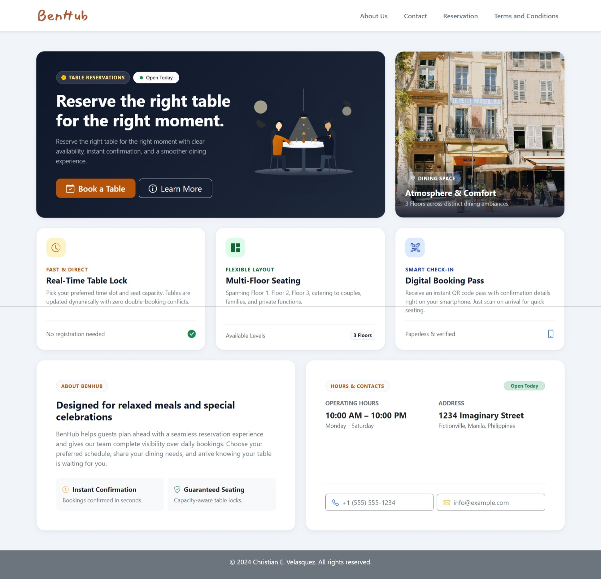
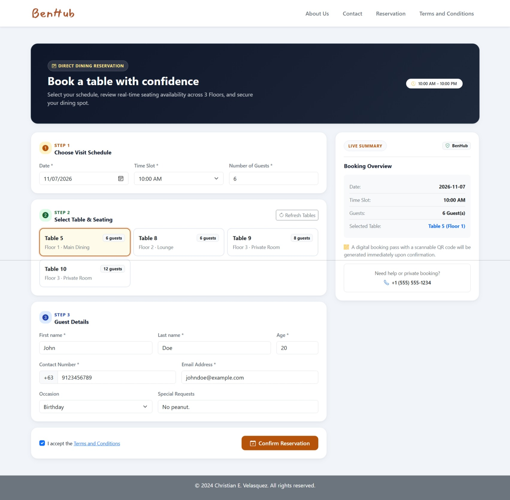
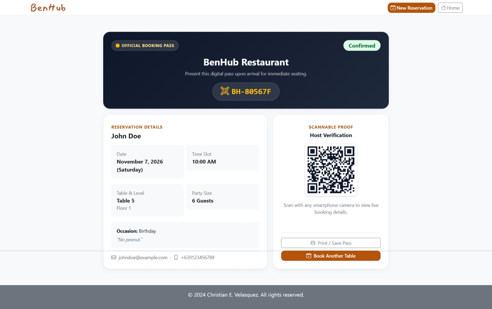
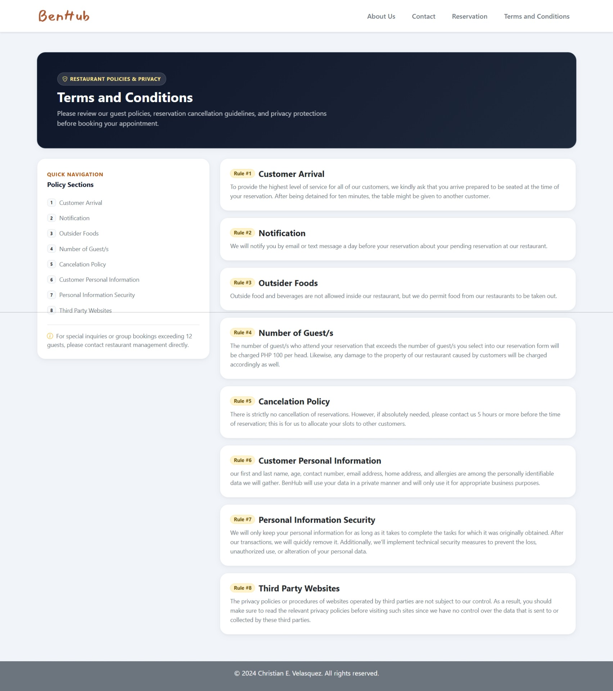
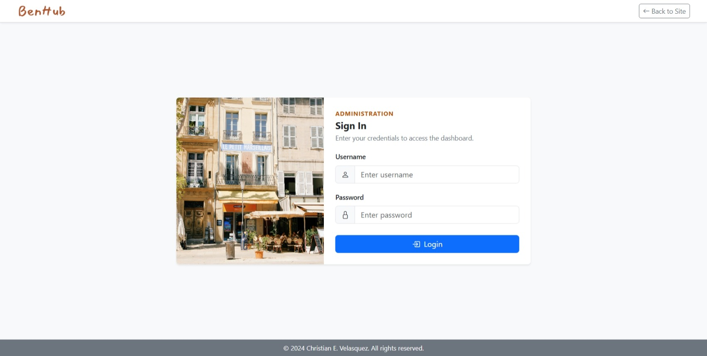
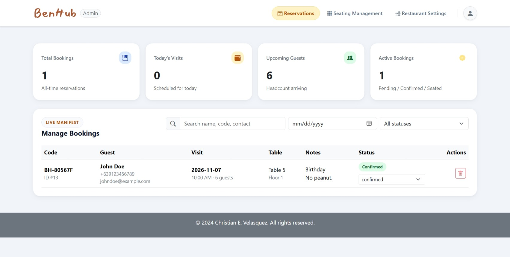
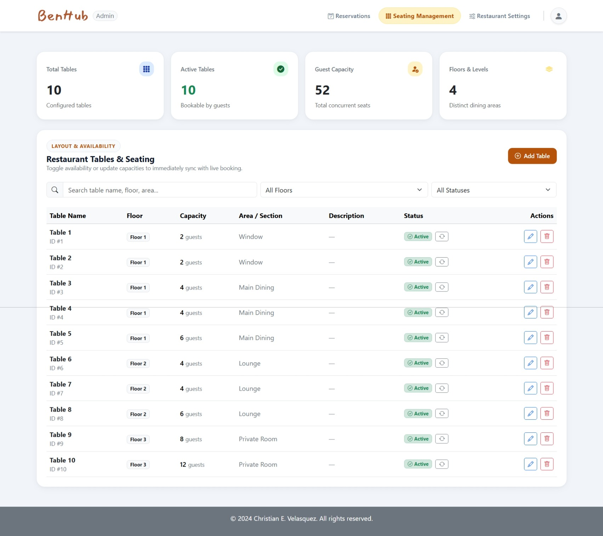
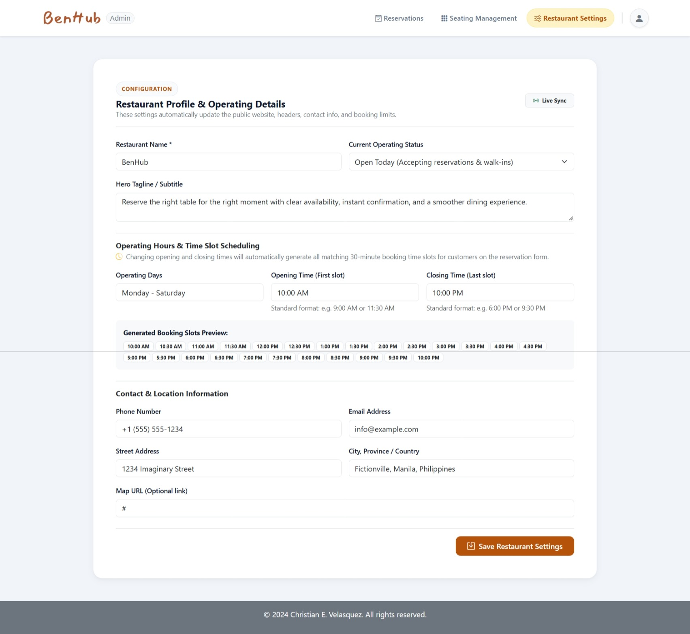

# BenHub — Modern Restaurant Reservation & Table Management System

[](https://www.php.net/)
[](https://www.postgresql.org/)
[](https://getbootstrap.com/)
[](https://en.wikipedia.org/wiki/Model%E2%80%93view%E2%80%93controller)
[](#ui-and-design-system)

**BenHub** is a full-stack, enterprise-grade restaurant appointment and floor management platform. Engineered from the ground up without bloated third-party frameworks, it utilizes a custom **Hybrid Architecture (Modular + Model-View-Controller + RESTful API)** to deliver instant table reservations, real-time table locking, dynamic operating hours, and digital QR booking passes.

---

## Key Features

### For Customers
- **Bento Grid UI**: A clean, responsive design inspired by modern Bento Grid aesthetics with a warm amber (`#b45309`) and slate navy palette.
- **Real-Time Table Availability**: Guests select their date, time slot, and party size (1–12 guests) to view currently available tables categorized by floor and dining area (Window, Main Dining, Lounge, Private Room).
- **Concurrency & Double-Booking Protection**: Powered by PostgreSQL partial unique indexes to guarantee zero race conditions or double-bookings.
- **Instant Digital QR Booking Pass**: Upon confirmation, guests receive a unique confirmation code (`BH-XXXXXX`) and a scannable QR pass for quick check-in upon arrival.
- **Single-Page Pass Printing**: Print-optimized stylesheet (`@media print`) that formats the booking voucher, visit details, and scannable QR code onto a single page.

### For Restaurant Administrators
- **Unified Admin Control Center**: Modern top navigation bar matching the public site, featuring an account avatar dropdown with quick site links and secure session logout.
- **Real-Time Operations Metrics**: Live counters tracking total bookings, today's arrivals, incoming headcount, and active dining reservations.
- **Reservation Lifecycle Management**: Filter, search, and update reservation statuses (`pending`, `confirmed`, `seated`, `completed`, `cancelled`, `no_show`) with confirmation modals.
- **Interactive Seating Management**: Create and configure tables across multi-level floors (`Floor 1`, `Floor 2`, `Floor 3`). Toggle active status on the fly, with safety checks preventing deletion of tables with active upcoming reservations.
- **Dynamic Restaurant Settings**: Edit restaurant name, tagline, contact information, physical address, and daily opening/closing operating hours with real-time dynamic 30-minute time slot generation.

---

## UI & Visual Walkthrough

### Customer Experience
| Bento Grid Homepage | Step-by-Step Table Booking |
|:---:|:---:|
|  |  |
| **Instant Scannable Digital Pass** | **Terms, Conditions & Policies** |
|  |  |

### Administrator Control Center
| Secure Admin Authentication | Reservations Lifecycle & Metrics |
|:---:|:---:|
|  |  |
| **Multi-Floor Seating Management** | **Restaurant Settings & Dynamic Hours** |
|  |  |

---

## Architectural Highlights

This project was built to demonstrate core software engineering principles:

1. **Modular MVC Pattern**: Code is organized into self-contained domain modules (`Auth`, `Admin`, `Reservation`, `Terms`, `Frontend`).
2. **Stateless RESTful APIs**: Controllers communicate with views via JSON endpoints following strict HTTP conventions (`GET`, `POST`, `PUT`, `PATCH`, `DELETE`).
3. **Database ACID Transactions**: Multi-table insertions across `reservation_info` and `customer_info` are wrapped in atomic transactions with automatic rollback on error.
4. **PostgreSQL Partial Unique Index**: Prevents table collision at the database engine level:
   ```sql
   CREATE UNIQUE INDEX unique_active_table_slot
   ON reservation_info (reservation_date, reservation_time, reservation_floor, reservation_table)
   WHERE status IN ('pending', 'confirmed', 'seated');
   ```
5. **No Framework Bloat**: Pure vanilla PHP 8+ PDO and a lightweight regex-based Front Controller (`Core\Router`), resulting in sub-millisecond route resolution.

---

## Project Structure

```text
p_001/
├── config/
│   ├── database.php.example    # Configuration template for PostgreSQL
│   └── database.php            # Active local connection (gitignored)
├── core/
│   ├── Database.php            # PDO Singleton connection manager with fallback
│   └── Router.php              # Central RESTful Front Controller router
├── docs/
│   └── screenshots/            # High-resolution UI walkthrough screenshots
├── modules/
│   ├── Admin/
│   │   └── Views/              # Admin dashboard and login interfaces
│   ├── Auth/
│   │   ├── Controllers/        # Admin authentication API controller
│   │   └── Models/             # Admin authentication model
│   ├── Frontend/
│   │   └── Views/              # Customer Home, Reservation, and Pass views
│   ├── Reservation/
│   │   ├── Controllers/        # Reservation, Seating, and Settings API controllers
│   │   └── Models/             # Data access layers (Reservation, Seating, Settings)
│   └── Terms/
│       ├── Controllers/        # Terms & conditions API controller
│       ├── Models/             # Terms data model
│       └── Views/              # Terms and policies view
├── public/
│   ├── index.php               # Public entry point & route definitions
│   ├── favicon.ico             # Proportional brand favicon
│   └── assets/
│       ├── bootstrap/          # Bootstrap v5.3 assets
│       ├── css/app.css         # Bento Grid design system & utility classes
│       ├── images/             # Logos, dining ambience photography, and icons
│       │   └── illustrations/  # Lightweight unDraw-style vector artwork
│       └── js/                 # Client-side libraries (QRCode.js)
├── benhub_postgres.sql         # Database schema, table indexes, and seed data
├── migrate.php                 # Database migration & admin credential setup script
└── README.md                   # Project documentation
```

---

## REST API Overview

| Method | Endpoint | Description | Auth Required |
|---|---|---|:---:|
| `GET` | `/api/settings` | Retrieve active restaurant settings & operating time slots | No |
| `POST` | `/api/settings` | Update restaurant settings & hours | **Yes (Admin)** |
| `GET` | `/api/reservations` | List all customer reservations | **Yes (Admin)** |
| `POST` | `/api/reservations` | Create a new table reservation | No |
| `GET` | `/api/reservations/availability` | Query available tables by date, time, and party size | No |
| `GET` | `/api/reservations/lookup` | Look up reservation details by confirmation code | No |
| `PUT` | `/api/reservations/{id}` | Update reservation status | **Yes (Admin)** |
| `DELETE` | `/api/reservations/{id}` | Remove a reservation | **Yes (Admin)** |
| `GET` | `/api/seatings` | List tables and floor summaries | **Yes (Admin)** |
| `POST` | `/api/seatings` | Add a new dining table | **Yes (Admin)** |
| `PATCH`| `/api/seatings/{id}/toggle` | Toggle table active availability | **Yes (Admin)** |
| `DELETE`| `/api/seatings/{id}` | Delete table (protected against active bookings) | **Yes (Admin)** |
| `POST` | `/api/auth/login` | Authenticate admin credentials | No |
| `POST` | `/api/auth/logout` | Terminate admin session | No |
| `GET` | `/api/terms` | Fetch terms and condition clauses | No |

---

## Getting Started

### Prerequisites
- **PHP 8.1+** with `pdo_pgsql` extension enabled.
- **PostgreSQL 14+** running locally or remotely.

### 1. Clone the Repository
```bash
git clone https://github.com/xtianvelasquez/p_001.git
cd p_001
```

### 2. Configure Environment & Database
Copy the database configuration template:
```bash
cp config/database.php.example config/database.php
```
Open `config/database.php` and update your PostgreSQL credentials:
```php
return [
    'host' => 'localhost',
    'port' => '5432',
    'dbname' => 'benhub',
    'user' => 'postgres',
    'password' => 'your_postgres_password'
];
```

### 3. Run Database Migrations
Execute the automated migration script or import `benhub_postgres.sql`:
```bash
php migrate.php
```
*Default admin credentials created: `admin` / `admin123`*

### 4. Launch the Development Server
Run PHP's built-in web server with `public/index.php` as the router:
```bash
cd public
php -S localhost:8000 index.php
```
Access the application in your browser:
- **Public Website & Booking**: `http://localhost:8000/`
- **Make a Reservation**: `http://localhost:8000/reservation`
- **Admin Dashboard**: `http://localhost:8000/admin` *(login at `/admin/login`)*

---

## Author & Acknowledgements

- **Developer**: [@xtianvelasquez](https://github.com/xtianvelasquez)
- **UI Architecture**: Custom Bento Grid CSS tokens & Bootstrap 5.3
- **Vector Artwork**: Minimalist unDraw vector illustrations matching the brand palette
